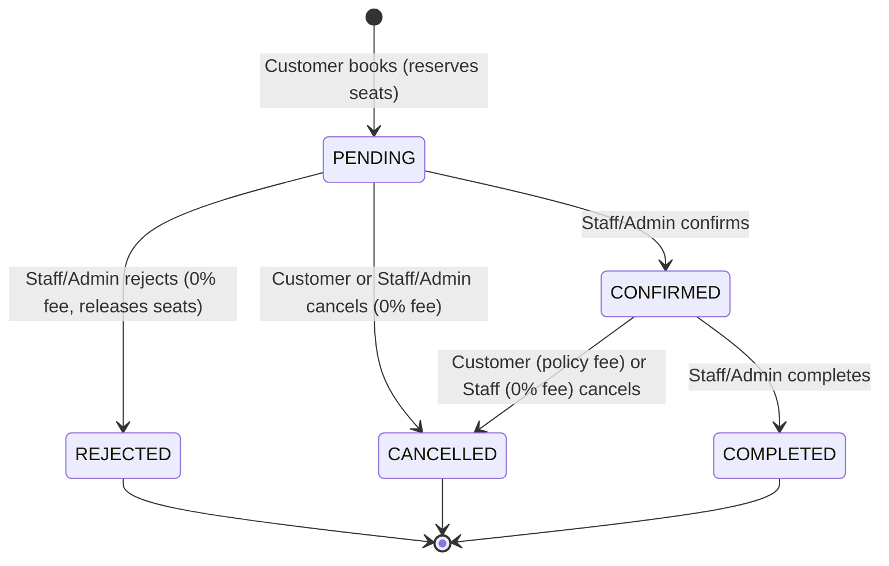

# Project Specification

## 1. Tech Stack

### Backend

- **Runtime & Language**: Node.js 22 LTS + TypeScript
- **Framework**: NestJS (REST API)
- **ORM & Migrations**: Prisma ORM
- **Validation**: `class-validator` + `class-transformer`
- **Testing**: Jest

### Frontend

- **Framework & Build Tool**: React + TypeScript + Vite
- **Routing**: React Router (permission-guarded routes via
  `<PermissionGuard />`)
- **State & Data Fetching**: Redux Toolkit (`@reduxjs/toolkit`, `react-redux`) +
  `axios`
- **Styling & UI**: Tailwind CSS

### Database

- **Primary Database**: PostgreSQL 16
- **Local Runtime**: Docker Compose (`postgres:16-alpine`)

### Auth

- **Mechanism**: Stateless JWT Access Token + HTTP-only Refresh Token
- **Password Hashing**: `bcrypt`
- **Authorization (RBAC)**: Permission-based RBAC (`ROLE_PERMISSIONS` mapping
  `CUSTOMER`, `STAFF`, `ADMIN` to atomic permissions)

## 2. Project Structure & Conventions

### 2.1 Repository Layout

```text
booking/
├── backend/                # NestJS REST API
│   ├── prisma/             # Schema, migrations, and seed
│   ├── src/
│   │   ├── common/         # Shared guards, decorators, filters
│   │   └── modules/        # Domain feature modules
│   ├── test/               # E2E tests
│   └── .env.example
├── frontend/               # React + TypeScript + Vite
│   ├── src/
│   │   ├── api/            # HTTP client & interceptors
│   │   ├── app/            # Redux store setup
│   │   ├── components/     # Shared UI components & layouts
│   │   ├── features/       # Domain feature slices & pages
│   │   └── routes/         # Routing & permission guards
│   └── .env.example
├── docs/                   # Project documentation & specs
├── docker-compose.yml      # Local multi-container orchestration
├── .env.example            # Root Docker Compose variables
├── .gitignore
└── README.md
```

### 2.2 Formatting & Conventions

- **Commit messages**: Max 72 characters per line; include issue reference
  `Refs #<issue-number>` (e.g., `Refs #123`).
- **Code & Markdown (`.ts`, `.js`, `.md`)**: Compatible with default VSCode
  Prettier extension.
- **TypeScript**: Enable `strict: true` in `tsconfig.json`.

## 3. Domain Workflows & RBAC Matrix

### 3.1 Intent, Scope & Business Rules

- **Goal**: Build a full-stack service-booking platform supporting customer
  discovery and reservation, staff catalog/schedule/booking operations, admin
  user governance, overbooking prevention, cancellation fee calculation, and
  operational reporting.
- **Non-Goals**:
  - Multi-night stays or arbitrary date-range bookings (e.g., hotel rooms).
  - Online payment gateway integration, invoicing, or multi-currency pricing.
  - Dynamic multi-tier cancellation policy administration.
- **Anti-Goals**:
  - Overbooking a schedule slot under concurrent booking requests.
  - Exposing another customer's bookings or permitting unauthorized actions.
  - Falling below `60%` unit-test coverage on backend services.
- **Bookable Entities (`PROVIDER` / `CATEGORY` 1:N `SERVICE` 1:N `SCHEDULE` 1:N
  `BOOKING`)**:
  - `Provider`: Vendor or facility with unique name, optional contact info, and
    active status; owns zero or more services.
  - `Category`: Service classification with unique `name`, unique `slug`
    (auto-derived from `name` and updated when `name` changes), and active
    status; categorizes zero or more services.
  - `Service`: Bookable offering belonging to one `Provider` and one `Category`,
    with name (unique per provider), optional description, `duration_minutes`
    (`> 0`, session length for catalog display and default schedule duration;
    edits apply to newly created schedules only), unit `price` (integer VND),
    default `capacity` (`>= 1`), `booking_mode`, and active status.
  - `Schedule`: Pre-created discrete time window (`start_time`–`end_time`)
    belonging to one `Service`, with `capacity` (`>= 1`, defaulting from
    `Service.capacity`), `booked_count` (`0..capacity`), and `is_active`.
    Availability state is derived: `DISABLED` if inactive, `FULL` if
    `booked_count = capacity`, otherwise `OPEN`.
  - `Booking`: Reservation linking one `CUSTOMER` and one `Schedule` (uniquely
    resolving `Service` and `Provider`), with requested `quantity` (`>= 1`),
    `is_exclusive`, `reserved_seats`, and snapshotted VND pricing.
- **Booking Modes & Exclusivity (`Service.booking_mode` +
  `Booking.is_exclusive`)**:
  - **`SHARED_ONLY`** (e.g., `Gym theo buổi`): Shared seat bookings only. Reject
    exclusive requests (`400`). Requires `booked_count + quantity <= capacity`;
    reserves `reserved_seats = quantity`; `total_price = unit_price * quantity`.
  - **`EXCLUSIVE_ONLY`** (e.g., private court or room): Private slot only
    (defaults exclusive; reject non-exclusive with `400`). Requires empty slot
    (`booked_count = 0`) and `1 <= quantity <= capacity`; reserves full
    `capacity`; flat pricing `total_price = unit_price`.
  - **`BOTH`** (e.g., `Spa 60 phút` 4-bed room): Supports shared bookings
    (`SHARED_ONLY` rules) and private buyout (requires `booked_count = 0` and
    `1 <= quantity <= capacity`, reserves full `capacity`, buyout pricing
    `total_price = unit_price * capacity`).
- **Overbooking Prevention**:
  - Booking creation requires an active, upcoming `Schedule`
    (`start_time > now`), active `Category`, `Service`, and `Provider`, and
    sufficient capacity for the selected booking mode; otherwise reject (`409`
    for capacity conflicts, `400` for past or inactive targets).
  - Seat reservation on creation (`PENDING`) and release on rejection or
    cancellation execute atomically so concurrent requests can never exceed
    `Schedule.capacity`.
- **Schedule & Catalog Mutation Rules**:
  - **Deactivation (`is_active = false`)**: Blocks _new_ bookings only; existing
    bookings remain intact and can still be processed by `STAFF`/`ADMIN` (or
    cancelled by `CUSTOMER` before `start_time`).
  - **Schedule Edits**: Block editing `start_time` or `end_time` (`409`) if any
    booking (any status) references the schedule. Block editing `capacity`
    (`409`) if any exclusive seat-holding booking (`PENDING`, `CONFIRMED`, or
    `COMPLETED`) exists. Otherwise reject `capacity < booked_count` (`400`).
  - **Service `booking_mode` Edits**: Apply to new bookings only; existing
    bookings remain consistent via snapshotted `is_exclusive` and
    `reserved_seats`.
  - **Immutable Ownership**: `Service.provider_id` and `Schedule.service_id`
    cannot be changed after creation (deactivate the old record and create a new
    one instead); `Service.category_id` remains editable.
  - **Schedule Overlap & Default Duration**: Parallel overlapping schedules
    under the same `Service` are allowed (e.g., multiple rooms or courts). When
    `end_time` is omitted on creation, it defaults to
    `start_time + service.duration_minutes`; explicit `end_time > start_time` is
    accepted.
- **Cancellation Policy (Fixed System-Wide Rules)**:
  - Customer cancels `PENDING`: `0%` fee.
  - Customer cancels `CONFIRMED` `>= 24 hours` before `start_time`: `0%` fee.
  - Customer cancels `CONFIRMED` `< 24 hours` before `start_time`: `50%` of
    `total_price` (rounded to the nearest integer VND).
  - Past `start_time`: Customer cancellation blocked (`400`).
  - `STAFF`/`ADMIN` rejection or cancellation: `0%` customer fee.
- **Staff State Transition Timing**:
  - `STAFF`/`ADMIN` transitions (`confirm`, `reject`, `cancel`, `complete`) have
    no wall-clock restriction.

### 3.2 Booking Lifecycle States



- **Terminal States**: `COMPLETED`, `CANCELLED`, `REJECTED` (further transitions
  return `409 Conflict`).
- **Seat Reservation**: `reserved_seats` is counted in `Schedule.booked_count`
  immediately upon entering `PENDING` and released upon `REJECTED` or
  `CANCELLED`.

### 3.3 Role Workflows

- **`CUSTOMER`**:
  - Register, login, refresh session, logout, and view own profile.
  - Browse, search, and filter active services (keyword, category, price range,
    provider, `booking_mode`); view service details and upcoming slots with
    remaining capacity (`capacity - booked_count`).
  - Create shared or exclusive bookings without exceeding remaining capacity.
  - View personal booking history (filterable by status and date).
  - Cancel own `PENDING` or `CONFIRMED` bookings subject to the fee policy.
- **`STAFF`**:
  - Manage providers, categories, services, and discrete service schedules (CRUD
    and enable/disable).
  - View all bookings and process state transitions (`confirm`, `reject`,
    `cancel`, `complete`).
  - View operational reports (detailed specification deferred).
- **`ADMIN`**:
  - Inherits all `STAFF` capabilities.
  - Manage user accounts: list users, update roles (`CUSTOMER`, `STAFF`,
    `ADMIN`), and activate/deactivate accounts (cannot self-deactivate or demote
    the last active `ADMIN`; deactivated accounts immediately lose API access
    and have active refresh sessions revoked).

### 3.4 Permission Matrix (`ROLE_PERMISSIONS`)

| Permission           | `Public` | `CUSTOMER` | `STAFF` | `ADMIN` |
| :------------------- | :------: | :--------: | :-----: | :-----: |
| `service:read`       |   Yes    |    Yes     |   Yes   |   Yes   |
| `service:manage`     |    No    |     No     |   Yes   |   Yes   |
| `provider:read`      |   Yes    |    Yes     |   Yes   |   Yes   |
| `provider:manage`    |    No    |     No     |   Yes   |   Yes   |
| `schedule:read`      |   Yes    |    Yes     |   Yes   |   Yes   |
| `schedule:manage`    |    No    |     No     |   Yes   |   Yes   |
| `booking:create`     |    No    |    Yes     |   No    |   No    |
| `booking:read_own`   |    No    |    Yes     |   No    |   No    |
| `booking:cancel_own` |    No    |    Yes     |   No    |   No    |
| `booking:read_all`   |    No    |     No     |   Yes   |   Yes   |
| `booking:process`    |    No    |     No     |   Yes   |   Yes   |
| `report:read`        |    No    |     No     |   Yes   |   Yes   |
| `user:manage`        |    No    |     No     |   No    |   Yes   |
